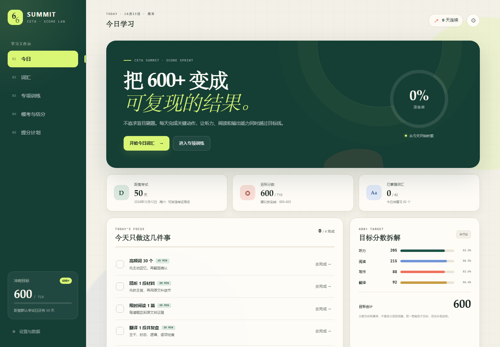
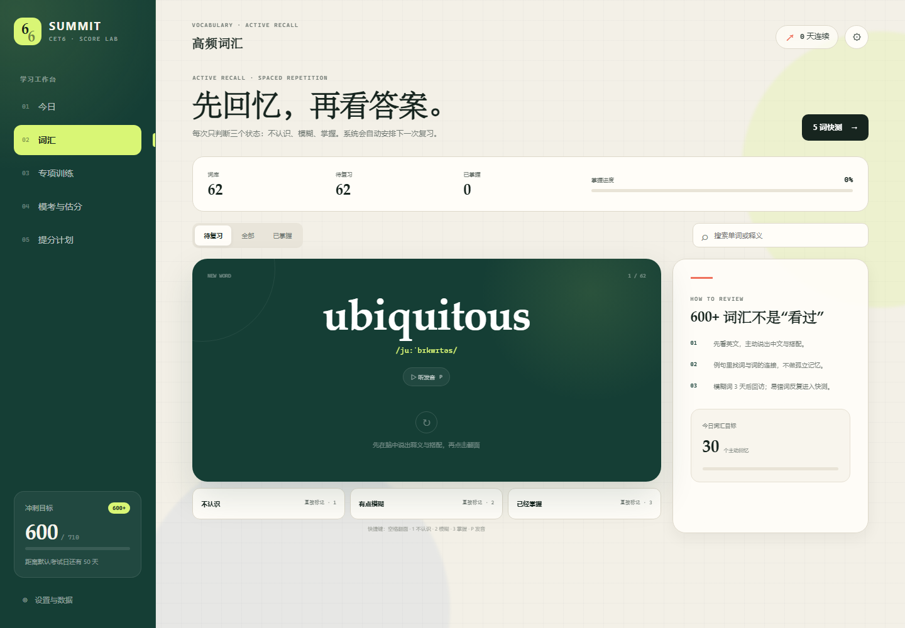
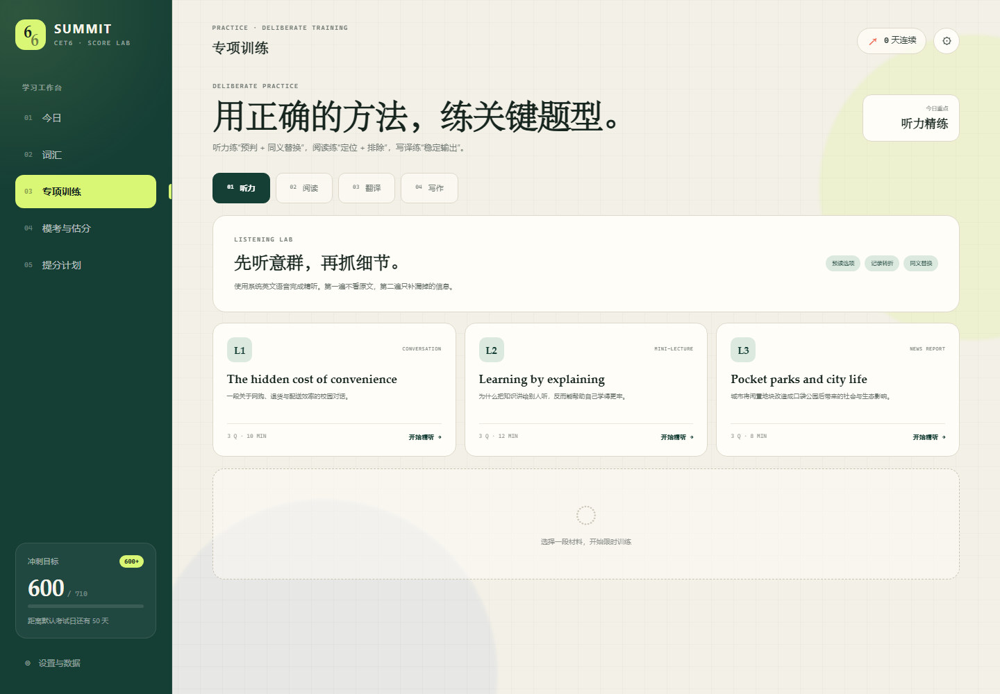
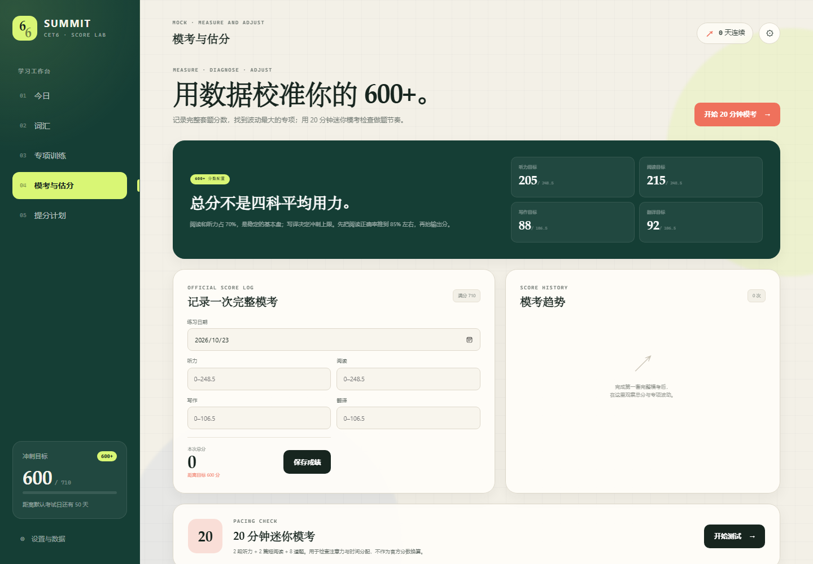
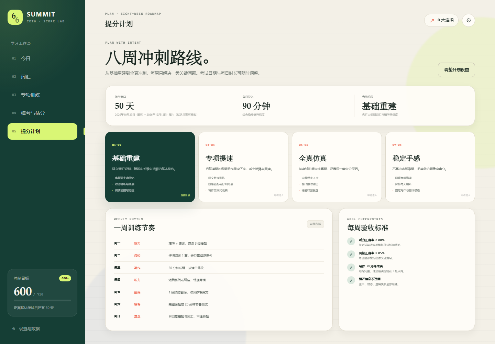
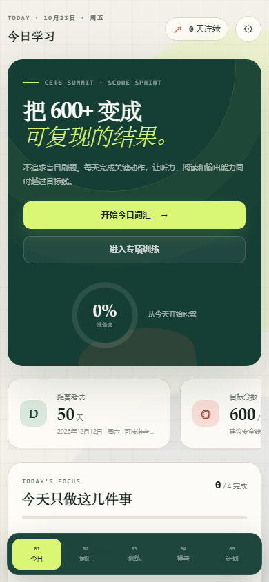

# CET6 Summit

### Climb toward 600+ with a smarter daily quest.

**CET6 Summit** is a gamified, offline-first study app for the Chinese College English Test Band 6. It turns an ambitious 600+ target into a daily rhythm of vocabulary recall, focused listening, timed reading, writing, translation, and mock-exam diagnostics.

[](./index.html)
[
[](./LICENSE)

> Open `index.html` and start studying. No account, package manager, server, or backend is required.

## App Preview

<p align="center">
  
</p>

<table>
  <tr>
    <td width="50%">
      
    </td>
    <td width="50%">
      
    </td>
  </tr>
  <tr>
    <td align="center"><b>Recall quests</b> · active recall with spaced repetition</td>
    <td align="center"><b>Skill arena</b> · timed listening and reading</td>
  </tr>
  <tr>
    <td width="50%">
      
    </td>
    <td width="50%">
      
    </td>
  </tr>
  <tr>
    <td align="center"><b>Score command center</b> · full-test logs and pacing checks</td>
    <td align="center"><b>Quest roadmap</b> · eight weeks from foundations to race day</td>
  </tr>
</table>

<p align="center">
  
</p>
<p align="center"><i>Same progress and learning loop on a phone-sized screen.</i></p>

## Why CET6 Summit?

- **A target you can inspect.** The 600-point goal is broken into listening, reading, writing, and translation checkpoints.
- **A daily loop, not a content dump.** The app builds today's plan from your available study time.
- **Recall before reveal.** Sixty-two high-value CET-6 words use active recall, pronunciation, collocations, and spaced repetition.
- **Practice with a clock.** Three listening sets, three reading passages, three translation prompts, and three writing prompts are built in.
- **Errors have a home.** Wrong listening and reading answers automatically enter the review notebook with explanations.
- **Progress stays with you.** Vocabulary history, drafts, streaks, mock scores, and mistakes are saved locally in the browser.
- **Designed for both screens.** The same app works as a desktop study dashboard or a phone-sized mini program.

## Quick Start

### Windows

Double-click:

```text
launch-cet6-summit.bat
```

### Any operating system

Open `index.html` in a modern browser. The app is dependency-free and can run directly from the filesystem.

On first use, open **Settings** and:

1. Confirm your exam date from your official admission ticket.
2. Choose a daily study window of 60, 90, or 120 minutes.
3. Set the built-in English speech rate.

Study records are stored under the browser's local storage for this file location. Use **Settings → Export learning data** before changing browsers, clearing site data, or moving the project.

## Feature Map

| Screen | What it does |
| --- | --- |
| **Today** | Countdown, daily quest checklist, streak, readiness estimate, weekly rhythm, and score target |
| **Vocabulary** | 62-word core deck, pronunciation, examples, and spaced review intervals |
| **Practice** | Timed listening and reading with grading; writing and translation with auto-saved drafts and references |
| **Mock & Score** | Full-test score log plus a 20-minute, eight-question pacing check |
| **Plan** | Eight-week roadmap, weekly rhythm, and 600+ checkpoints |

## The 600+ Score Model

CET6 Summit uses the following diagnostic split:

| Section | Target | Maximum |
| --- | ---: | ---: |
| Listening | 205 | 248.5 |
| Reading | 215 | 248.5 |
| Writing | 88 | 106.5 |
| Translation | 92 | 106.5 |
| **Total** | **600** | **710** |

This split is a study-planning reference, **not an official scoring conversion**. Use past official CET-6 papers and official assessment criteria for real preparation. Adjust your weakest section based on complete mock tests.

## Privacy

- No account or login
- No analytics or trackers
- No network requests during normal use
- No backend or cloud storage
- All user-created notes and progress remain in browser local storage

## Project Structure

```text
.
├── index.html              # App shell and content structure
├── styles.css              # Responsive visual system
├── data.js                 # Vocabulary and practice content
├── app.js                  # Plans, review algorithm, grading, and persistence
├── docs/screenshots/       # README product previews
├── launch-cet6-summit.bat  # Windows one-click launcher
├── LICENSE
└── README.md
```

## Contributing

Contributions are welcome. Useful next steps include expanding the original practice library, adding more original reading passages, improving screen-reader support, and adding an import flow for exported study data.

1. Fork the repository.
2. Create a focused branch.
3. Keep the app dependency-free unless a new dependency has a clear benefit.
4. Test on both desktop and mobile widths.
5. Open a pull request with clear before/after context.

Please use original practice content or material you have permission to redistribute. Do not add copyrighted past papers or commercial question banks.

## License

MIT © 2026 Huiteng Zhuang. See [LICENSE](./LICENSE).
